<div align="center">

<a href="https://pixeltable.com">
  <picture>
    <source media="(prefers-color-scheme: dark)" srcset="./assets/hero-dark.svg">
    <source media="(prefers-color-scheme: light)" srcset="./assets/hero-light.svg">
    
  </picture>
</a>

<br/>

[](https://pixeltable.com)
[](https://docs.pixeltable.com)
[](https://pierrebrunelle.github.io/awesome-pixeltable-apps/)
[](https://x.com/pjlbrunelle)
[](https://www.linkedin.com/in/brunellepe/)

</div>

---

### What I'm Building

I'm Co-Founder & CEO of **[Pixeltable](https://github.com/pixeltable/pixeltable)** — open-source Python infrastructure that unifies **multimodal storage, incremental computation, vector indexing, tool-calling agents, and FastAPI serving** in a single declarative `app.py`.

<!-- PIXELTABLE-META:START -->
> 📦 **Latest release:** [`v0.7.21`](https://github.com/pixeltable/pixeltable/releases/tag/v0.7.21) &nbsp;·&nbsp; ⭐ **1,647 stars** &nbsp;·&nbsp; 🍴 **231 forks** &nbsp;·&nbsp; 🧪 **[38 runnable example apps](https://pierrebrunelle.github.io/awesome-pixeltable-apps/)**
<!-- PIXELTABLE-META:END -->

---

### Featured Systems, Galleries & Agent Skills

| Repository | What it does | Try / Install |
| :--- | :--- | :--- |
| **[`pixeltable/pixeltable`](https://github.com/pixeltable/pixeltable)** | **The backend agents build with.** Declarative tables (`TableModel`), incremental computed columns, hybrid vector search (`EmbeddingIndex`), media storage, and HTTP serving (`FastAPIRouter`) in one file. | `pip install 'pixeltable[serve]'` |
| **[`awesome-pixeltable-apps`](https://github.com/pierrebrunelle/awesome-pixeltable-apps)** | Curated gallery of self-contained multimodal AI apps & REST APIs built with Pixeltable. Open any app in GitHub Codespaces or deploy to Pixeltable Cloud. | **[Browse Live Gallery →](https://pierrebrunelle.github.io/awesome-pixeltable-apps/)** |
| **[`challenge-the-design`](https://github.com/pierrebrunelle/challenge-the-design)** | Agent skill & plugin that reviews a PR or stack as an ensemble, separates requirements from assumptions, and runs a behavior-preserving deletion pass before checking implementation. | `npx skills add pierrebrunelle/challenge-the-design` |
| **[`marcel-review`](https://github.com/pierrebrunelle/marcel-review)** | Agent skill that reviews a change the way [Marcel Kornacker](https://github.com/mkornacker) reviews it: crisp abstractions, ownership, failure paths, and what the change costs its future readers. | `npx skills add pierrebrunelle/marcel-review` |
| **[`mcp-server-openai`](https://github.com/pierrebrunelle/mcp-server-openai)** & **[`infinite-memory-discord-bot`](https://github.com/pierrebrunelle/infinite-memory-discord-bot)** | Model Context Protocol server bridging Claude & OpenAI models, plus a stateful Discord agent with durable semantic memory backed by Pixeltable. | **[Explore Repos →](https://github.com/pierrebrunelle?tab=repositories)** |

---

### Latest Runnable Pixeltable Apps

<!-- AWESOME-APPS:START -->
_Auto-synced from [`pierrebrunelle/awesome-pixeltable-apps`](https://github.com/pierrebrunelle/awesome-pixeltable-apps) (38 apps total, newest first):_

| App | Architecture & Features | Launch |
| :--- | :--- | :---: |
| **[Observatory Night Log](https://github.com/pierrebrunelle/pixeltable-observatory-night-log)**<br><sub>2026-10-26</sub> | Migrate a messy legacy observatory night log CSV into Pixeltable without losing a row: parse coordinates and photometry as computed columns, keep each failed parse as a per-column error, fix the source values and recompute only the failed cells<br><sub>`Computed columns & UDFs` · `B-tree indexes`</sub> | [](https://codespaces.new/pierrebrunelle/pixeltable-observatory-night-log?quickstart=1) |
| **[Procurement Approval Agent](https://github.com/pierrebrunelle/pixeltable-procurement-agent-audit)**<br><sub>2026-10-25</sub> | Procurement approval agent whose every decision is versioned: read the agent's verdicts as of any table version, see why one request was decided the way it was across policy changes, roll back a bad policy rollout with revert() and freeze a quarter-close snapshot<br><sub>`Versioning & snapshots` · `AI model functions` · `Computed columns & UDFs` · `pxt CLI & dashboard` · `B-tree indexes`</sub> | [](https://codespaces.new/pierrebrunelle/pixeltable-procurement-agent-audit?quickstart=1) |
| **[Theater Rehearsal Call Board](https://github.com/pierrebrunelle/pixeltable-rehearsal-call-board)**<br><sub>2026-10-24</sub> | Stage-management dashboard for a Twelfth Night rehearsal period: call hours, punctuality, absences and department notes from joins and JSON list functions, plus OpenTelemetry traces of every Pixeltable operation stored back in a table<br><sub>`pxt CLI & dashboard` · `Computed columns & UDFs` · `B-tree indexes`</sub> | [](https://codespaces.new/pierrebrunelle/pixeltable-rehearsal-call-board?quickstart=1) |
| **[Marketplace Listing Photo & Video Moderation](https://github.com/pierrebrunelle/pixeltable-listing-photo-moderation)**<br><sub>2026-10-23</sub> | Trust-and-safety pipeline for marketplace listings: text moderation, a gpt-4o-mini vision verdict with boxes, box post-processing and mAP against human labels, per-frame video checks and voice-over transcripts scanned for off-platform contact<br><sub>`Media (images)` · `AI model functions` · `Computed columns & UDFs` · `B-tree indexes`</sub> | [](https://codespaces.new/pierrebrunelle/pixeltable-listing-photo-moderation?quickstart=1) |
| **[Bakery Order Ledger](https://github.com/pierrebrunelle/pixeltable-bakery-order-ledger)**<br><sub>2026-10-22</sub> | Bakery order ledger with a built-in audit trail: every edit is a Pixeltable table version, so you can read the ledger as of any version, diff two versions by order, restore a deleted order, freeze end-of-day snapshots and roll back a bad bulk edit<br><sub>`Versioning & snapshots` · `Computed columns & UDFs` · `pxt CLI & dashboard` · `Pixeltable Cloud` · `B-tree indexes`</sub> | [](https://codespaces.new/pierrebrunelle/pixeltable-bakery-order-ledger?quickstart=1) |

<div align="right">
  <sub><a href="https://pierrebrunelle.github.io/awesome-pixeltable-apps/">Browse all 38 runnable apps in the interactive gallery →</a></sub>
</div>
<!-- AWESOME-APPS:END -->

---

### Deep Dives

<details>
<summary><b>⚡ 60-Second Quickstart: One-File Multimodal Backend (<code>app.py</code>)</b></summary>
<br/>

With Pixeltable, your schema, computed columns, vector indexes, and HTTP routes live in a single declarative `app.py` — no separate vector DB, no `for row in ...:` model loops, and no imperative glue:

```python
import pixeltable as pxt
import pixeltable.functions as pxtf
from pixeltable.functions.openai import embeddings
from pixeltable.serving import FastAPIRouter

TableModel = pxt.model_base()


@pxt.udf
def excerpt(text: str, n: int = 120) -> str:
    return text if len(text) <= n else f'{text[:n]}...'


class Docs(TableModel, name='docs'):
    id = pxt.Column(value=pxtf.uuid.uuid7(), primary_key=True)
    title: pxt.String
    body: pxt.String
    image: pxt.Image | None
    summary = excerpt(body)

    __indexes__ = [
        pxt.EmbeddingIndex(column=body, string_embed=embeddings.using(model='text-embedding-3-small'))
    ]


api = FastAPIRouter(name='ingest')
api.add_insert_route(Docs, path='/docs', inputs=[Docs.title, Docs.body, Docs.image], outputs=[Docs.id, Docs.summary])
```

Run locally or deploy the exact same `app.py` to **Pixeltable Cloud**:

```bash
# Local
pip install 'pixeltable[serve]'
pxt init
pxt schema update app.py my_app
pxt service update app.py my_app -f

# Pixeltable Cloud
pxt login
pxt db update pxt://org:db -f
pxt schema update app.py pxt://org:db -f
pxt service update app.py pxt://org:db -f
```

</details>

<details>
<summary><b>🧭 Engineering &amp; Code Review Philosophy: Delete Before You Abstract</b></summary>
<br/>

Whether designing multimodal infrastructure or reviewing pull requests with [`challenge-the-design`](https://github.com/pierrebrunelle/challenge-the-design) and [`marcel-review`](https://github.com/pierrebrunelle/marcel-review), I optimize for a few non-negotiable invariants:

1. **State the problem and a measurable falsifier first.** Separate true requirements from inherited assumptions before writing code.
2. **Delete unnecessary work before adding abstractions.** Run a behavior-preserving deletion pass across the whole ensemble (callers, state, and tests) before introducing new layers.
3. **Every abstraction must earn its keep.** A class or function should represent a crisp contract that can be stated in one sentence—and its docstring should state only what the signature does not.
4. **Declarative state over imperative glue.** If progress and lineage live in rows and computed columns rather than ephemeral in-memory loops, retries, caching, and observability become properties of the table engine.

</details>

<details>
<summary><b>🏗️ Career Arc: Structural Engineering → Decision Science → AI Infrastructure</b></summary>
<br/>

- **[Pixeltable](https://pixeltable.com)** — *Co-Founder & CEO* · Building open-source multimodal AI data infrastructure and Pixeltable Cloud (`pxt://`).
- **[Noteable](https://github.com/noteable-io)** *(acquired by **[Confluent](https://github.com/confluentinc)**)* — *Co-Founder* · Built the collaborative data notebook platform bridging Python, SQL, and interactive analytics, and pioneered early ChatGPT Code Interpreter / Notebook plugin workflows.
- **Amazon & AWS** — *Decision Scientist & Product/Data Leader* · Applied econometrics, optimization, and large-scale cloud data systems across AWS and Amazon consumer/infrastructure teams.
- **Siemens & Structural Engineering** — Started my career in structural engineering and industrial systems, where load paths, safety margins, and failure modes are calculated before anything is built.

</details>
